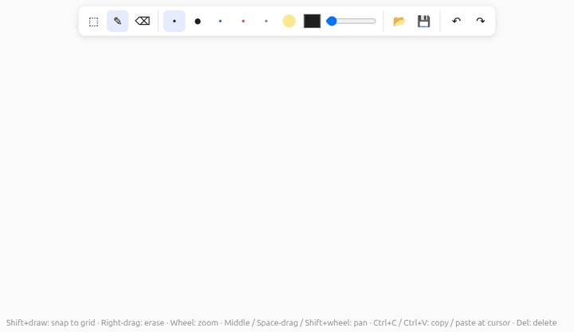

#  Draw Board

A whiteboard where your hand never leaves the drawing to visit a toolbar.

[](https://drawboardweb.netlify.app)

**[▶ Try it in your browser](https://drawboardweb.netlify.app)** (no install; the board is kept in your browser's local storage)

Most drawing apps make you switch tools for every small thing: pick the eraser, erase,
pick the pen again; grab the hand tool to move around; come back. Draw Board puts the
everyday actions on the mouse itself, so you can **draw, navigate and erase without
changing tools**:

| You want to | Do this |
|---|---|
| Draw | left-drag |
| Erase | right-click a stroke, or right-drag across strokes: they grey out, releasing deletes them (`Esc` cancels) |
| Draw a straight line | hold `Shift` while drawing: the pen snaps to the dot grid |
| Zoom | mouse wheel (pinch on a trackpad) |
| Move around | middle-drag, Space+drag or Shift+wheel; the canvas is infinite |
| Change pen | `1`–`6`: OneNote-style color + thickness presets |

Everything else is there when you need it: select and move/resize (`V`), copy/paste at
the cursor (`Ctrl+C`/`Ctrl+V`), paste images, undo (`Ctrl+Z`), and save/open (`Ctrl+S`/`Ctrl+O`)
as plain `.svg` files that open anywhere and can be edited in Inkscape and opened again.

Runs in the browser and as a desktop app (Electron); the board is saved automatically.

## Google Drive (web version)

Click the Google Drive button in the toolbar to connect. The board then syncs to
`draw_board_files/board.svg` in your Drive: it is pulled again when you come back to the tab, the
newer copy wins, and Ctrl+Z brings back the one it replaced. Click the button again for your
drawings in that folder: open one, or *Save board as…* a new one; Ctrl+S then saves back to it.
The app can only see files it created (`drive.file`). [Privacy](https://drawboardweb.netlify.app/privacy.html).

Lightweight by design: there is no backend, the page gets short-lived tokens straight from Google.
So each new tab needs one click on the Drive button, and when the hourly token runs out your next
click on the board renews it (a popup flashes for a second; no password). Not in the desktop app yet.

Setup, once: in the [Google Cloud console](https://console.cloud.google.com/) create a project, enable
the **Google Drive API**, configure the **OAuth consent screen** (External; add yourself as a test
user), then **Credentials → Create OAuth client ID** of type *Web application* with authorized
JavaScript origins `https://drawboardweb.netlify.app`, `http://localhost:5173`,
`http://localhost:3000` and `http://localhost:4173`. Put the client ID in `.env` as
`VITE_GOOGLE_CLIENT_ID` and rebuild.

## Run

```bash
npm install
npm run build && npm start    # browser: http://localhost:3000
npm run electron              # desktop app
npm run dist:electron         # package the desktop app into release/
npm run deploy                # publish the web version to Netlify
npm test
```

## Acknowledgments

- Built together with [Claude](https://claude.ai) (Anthropic's Claude Opus 5.5 in [Claude Code](https://claude.com/claude-code)), which wrote most of the code from my requirements.
- [TypeScript](https://www.typescriptlang.org/), [Vite](https://vite.dev/) and [Node.js](https://nodejs.org/) for the app and its small backend.
- [Electron](https://www.electronjs.org/) and [electron-builder](https://www.electron.build/) for the desktop app.

